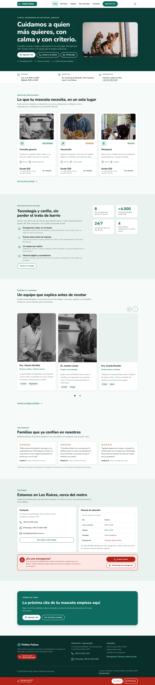

# Patitas Felices — Proyecto UI/UX

Diseño completo del sitio web responsive de **Patitas Felices**, una clínica veterinaria de barrio (ficticia) en Caracas, Venezuela. El objetivo del enunciado: que cualquier dueño de mascota pueda **informarse, confiar en la clínica y agendar una cita en menos de 2 minutos**, desde el celular o la computadora.

Proyecto académico de **Lenin Alvarado** · Lexpin · 2026 · Enunciado: [`Proyecto_UIUX_Patitas_Felices.pdf`](Proyecto_UIUX_Patitas_Felices.pdf)



## Entrega

| Pide el enunciado | Dónde está |
|---|---|
| Enlace al archivo de diseño | [`site/documentacion/pantallas.html`](site/documentacion/pantallas.html) · capturas en [`docs/assets/pantallas/`](docs/assets/pantallas/) |
| Enlace al prototipo navegable | [`site/`](site/) (ver [Cómo ejecutar](#cómo-ejecutar)) |
| PDF de máximo 8 páginas | [`docs/informe.pdf`](docs/informe.pdf) (8 páginas) |

El prototipo es un sitio real en HTML, CSS y JavaScript, sin framework ni paso de compilación. El enunciado permite "Figma, Penpot, Adobe XD u otra"; aquí la herramienta es código, para que el prototipo se pueda recorrer de verdad con clics.

## Actividades del enunciado

### 1. Investigación (UX) — [`docs/01-investigacion.md`](docs/01-investigacion.md)

- **1.1 Proto-personas:** 5 tipos de cliente, cada uno con el motivo por el que visitaría el sitio. Se eligieron 3 perfiles muy distintos (Camila, primera mascota y todo desde el celular; Rafael, adulto mayor con tres mascotas y nivel digital bajo; la familia Rojas, que decide en conjunto). Cada persona tiene todos los campos pedidos, supuestos justificados y decisiones de diseño concretas.
- **1.2 User journey map:** el escenario «Mi mascota amaneció decaída…» en las 6 etapas (Detección → Post-cita), con acciones, pensamientos, curva de emoción ([`journey-emociones.svg`](docs/assets/journey-emociones.svg)), puntos de contacto, puntos de dolor y oportunidades.
- **1.3 Análisis de competencia:** 3 sitios reales (Veterinaria Los Chorros y DogtorVet, de Caracas, y Vets4Pets, del Reino Unido), revisados a 1440 y 390 px ([capturas](docs/assets/competencia/)). Incluye la tabla con todos los criterios y la conclusión.

### 2. Arquitectura de información — [`docs/02-arquitectura.md`](docs/02-arquitectura.md)

- **2.1 Sitemap:** card sorting hecho por cada persona y árbol de niveles 0, 1 y 2 con los elementos globales aparte ([`sitemap.svg`](docs/assets/sitemap.svg)). El menú tiene 6 opciones y ninguna página importante queda a más de 3 clics.
- **2.2 User flow «Agendar una cita»:** simbología estándar, 3 puntos de entrada, el camino ideal completo y las 5 rutas alternativas obligatorias: emergencia, horario no disponible, campos inválidos, volver sin perder datos y abandono ([`user-flow.svg`](docs/assets/user-flow.svg)). Termina con el conteo de clics, pantallas y tiempo.

### 3. Wireframes (baja fidelidad) — [`site/wireframes/`](site/wireframes/)

11 wireframes en escala de grises, sin imágenes finales: las 10 pantallas requeridas más «Mis mascotas».

### 4. Diseño UI (alta fidelidad)

- **Guía de estilos:** [`site/guia-de-estilos.html`](site/guia-de-estilos.html). Incluye la paleta clara y oscura, la tipografía Nunito, los botones y campos con todos sus estados, la iconografía (Lucide) y el logo.
- **Pantallas finales a 1440 y 390 px:** [`docs/assets/pantallas/`](docs/assets/pantallas/).
- **Justificación de las decisiones:** [`docs/03-decisiones.md`](docs/03-decisiones.md).

### 5. Prototipo navegable

El flujo completo de «agendar cita» se recorre con clics siguiendo el user flow:
Inicio → Paso 1 (servicio y mascota) → Paso 2 (fecha y hora) → Paso 3 (datos del dueño y confirmación) → Cita confirmada.
Todas las rutas alternativas del flujo están implementadas y cubiertas por pruebas automáticas.

## Pantallas requeridas

| # | Pantalla | Archivo |
|---|---|---|
| 1 | Inicio | [`site/index.html`](site/index.html) |
| 2 | Servicios con precios referenciales | [`site/servicios.html`](site/servicios.html) |
| 3 | Detalle de un servicio | [`site/servicio.html`](site/servicio.html) (`?s=consulta`, `vacunacion`, `cirugia`, `peluqueria` o `emergencias`) |
| 4 | Nuestro equipo | [`site/equipo.html`](site/equipo.html) |
| 5 | Agendar cita, paso 1 | [`site/agendar.html`](site/agendar.html) |
| 6 | Agendar cita, paso 2 | [`site/agendar-paso-2.html`](site/agendar-paso-2.html) |
| 7 | Agendar cita, paso 3 | [`site/agendar-paso-3.html`](site/agendar-paso-3.html) |
| 8 | Cita confirmada (calendario `.ics` y WhatsApp) | [`site/cita-confirmada.html`](site/cita-confirmada.html) |
| 9 | Contacto y ubicación | [`site/contacto.html`](site/contacto.html) |
| 10 | Error 404 con el estilo de la marca | [`site/404.html`](site/404.html) |

## Requisitos obligatorios

| Requisito | Cómo se cumple |
|---|---|
| Diseño mobile-first | Se diseñó primero para 390 px; las pruebas cubren 390 y 1440 px |
| Contraste WCAG AA | 148 de 148 combinaciones de color aprobadas (`pnpm test:contrast`), en tema claro y oscuro |
| Emergencias siempre a mano | Botón de emergencias fijo en todas las páginas |
| Estados de los componentes | Hover, activo, deshabilitado y error; se pueden ver en la guía de estilos |
| Consistencia visual | Mismos tokens de diseño, mismo header y footer en todas las pantallas |

## Puntos opcionales

- ✅ «Mis mascotas» con el historial de vacunas: [`site/mis-mascotas.html`](site/mis-mascotas.html)
- ✅ Modo oscuro (botón en el header; también respeta la preferencia del sistema)
- ✅ Microinteracciones animadas, que se desactivan con `prefers-reduced-motion`
- ⬜ Prueba de usabilidad: no se realizó

## Cómo ejecutar

Requisitos: **Node.js 22.12 o superior** y **pnpm**.

```bash
pnpm install
pnpm serve        # abre el sitio en http://localhost:4321
```

El flujo de reserva usa `sessionStorage`, así que el sitio necesita un servidor HTTP; abrirlo con `file://` no funciona.

### Pruebas y artefactos

```bash
pnpm exec playwright install chromium   # solo la primera vez
pnpm test            # 197 pruebas: páginas, flujo de reserva, accesibilidad (axe), movimiento y stepper
pnpm test:contrast   # auditoría de contraste WCAG AA
pnpm capture         # regenera las capturas de docs/assets/pantallas/
pnpm docs            # regenera site/documentacion/ a partir de docs/*.md
pnpm pdf             # regenera docs/informe.pdf
```

## Estructura

```text
.
├── Proyecto_UIUX_Patitas_Felices.pdf   # enunciado
├── docs/                               # entregables escritos
│   ├── 01-investigacion.md             # 1. Investigación
│   ├── 02-arquitectura.md              # 2. Arquitectura de información
│   ├── 03-decisiones.md                # Justificación de las decisiones de diseño
│   ├── informe.html / informe.pdf      # PDF de entrega (8 páginas)
│   ├── creditos.md                     # Licencias de fotos, iconos y tipografía
│   └── assets/                         # Diagramas, competencia y pantallas
├── site/                               # prototipo navegable
│   ├── *.html                          # pantallas requeridas y extras
│   ├── guia-de-estilos.html            # 4. Guía de estilos
│   ├── wireframes/                     # 3. Wireframes
│   ├── documentacion/                  # documentación publicada (generada desde docs/)
│   └── assets/                         # CSS, JS, fuentes, imágenes
├── tests/                              # pruebas Playwright y scripts de generación
```

## Datos y créditos

La clínica, la dirección, los teléfonos, los precios, el equipo, las mascotas y los testimonios son **ficticios**. Las fotos son de Pexels: las del equipo son fotos de stock de prueba y no muestran personal real. Los iconos son de Lucide (ISC) y el de WhatsApp de Simple Icons (CC0). La tipografía Nunito usa la licencia SIL OFL 1.1. El logo es una composición propia. El detalle completo está en [`docs/creditos.md`](docs/creditos.md).
