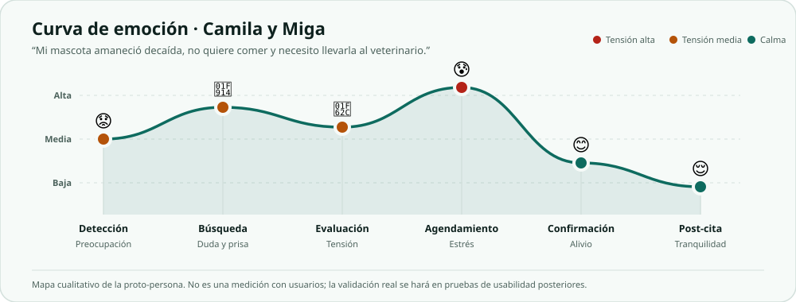
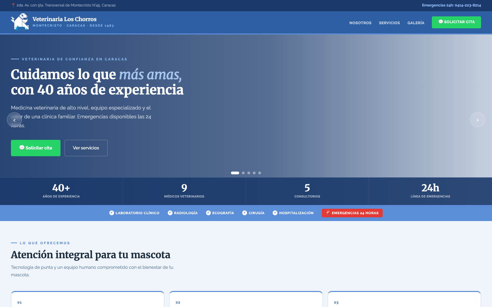
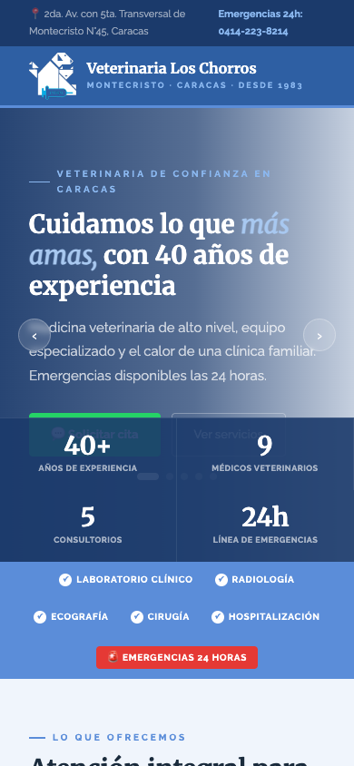
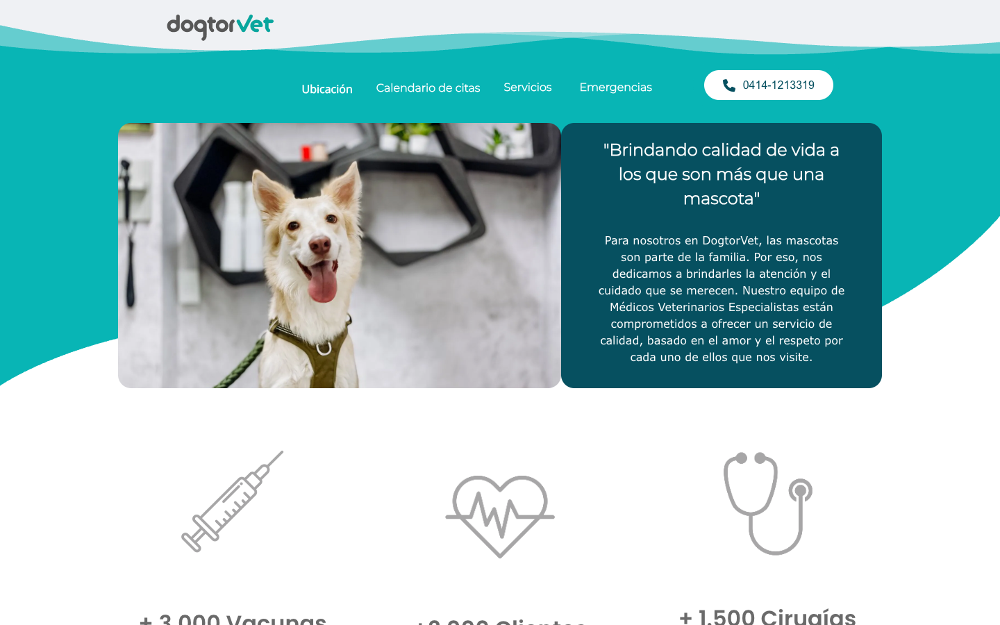
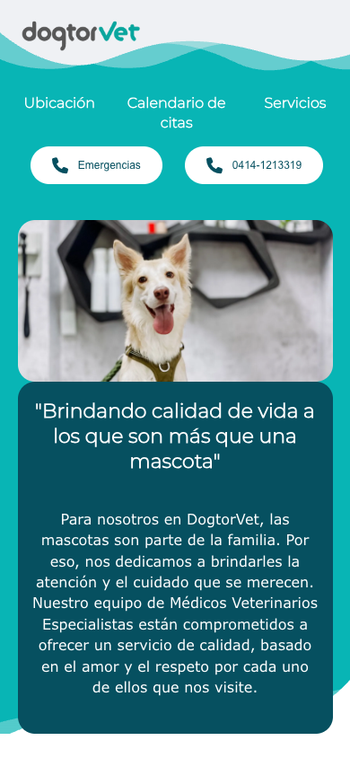
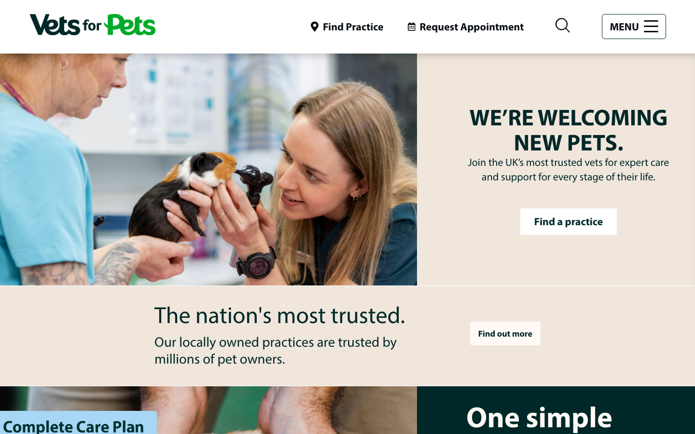
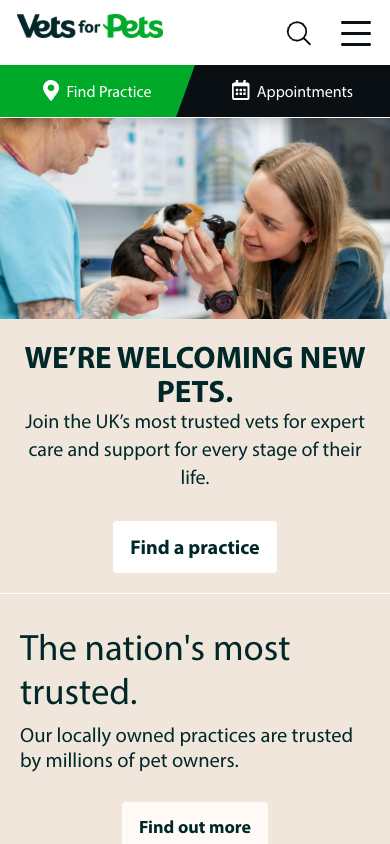

# Investigación UX — Patitas Felices

**Proyecto:** sitio web de la clínica veterinaria Patitas Felices (Caracas, Venezuela)  
**Autor:** Lenin Alvarado  
**Fecha de la investigación:** 2026-10-29  
**Alcance:** proto-personas (S1), journey map (S2) y análisis de competencia (S3).

> **Nota metodológica.** Las personas, nombres, mascotas y frases de este documento son ficticios y se construyeron con lógica, no con entrevistas. Los supuestos indican el *tipo* de fuente que los inspira (reseñas de Google Maps, publicaciones de Instagram, grupos de Facebook u observación de sitios) y son hipótesis de diseño, no hallazgos verificados; no se transcribe ni se atribuye ninguna opinión a una persona o a un negocio real. Los datos de la clínica Patitas Felices también son ficticios.

---

## 1. Tipos de cliente (S1)

Se identificaron cinco tipos de cliente posibles para una clínica veterinaria de barrio en Caracas. La última columna explica, en una línea, por qué visitaría el sitio.

| # | Tipo de cliente | Por qué visitaría el sitio |
|---|---|---|
| 1 | Persona joven con su primera mascota | Busca información confiable, precios y una forma rápida de agendar desde el celular sin llamar. |
| 2 | Adulto mayor con varias mascotas | Necesita llamar o escribir por WhatsApp, ver horarios, dirección y atención de emergencia sin navegar menús complejos. |
| 3 | Familia con niños y un perro | Quiere confirmar que la clínica es confiable, comparar precios y agendar alrededor de la rutina escolar. |
| 4 | Dueño de una mascota exótica | Necesita saber si atienden aves, reptiles o roedores y encontrar información específica antes de trasladar al animal. |
| 5 | Dueño de una mascota con enfermedad crónica | Requiere controles frecuentes, historial de vacunas, recordatorios y acceso rápido a la evolución de su mascota. |

### 1.1. Tres perfiles elegidos y justificación

Se eligieron **Camila (24 años, nivel digital alto, primera mascota)**, **Rafael (68 años, nivel digital bajo, tres mascotas)** y **la familia Rojas (38–40 años, nivel digital medio, dos niños y un perro)**.

> La selección cubre los extremos de edad y habilidad tecnológica: una nativa digital que agenda sola, un adulto mayor que prefiere el teléfono y una familia que decide en pareja y compara antes de pagar.  
> La necesidad principal también cambia: primera experiencia y urgencia; continuidad y atención humana; confianza, precio y organización familiar.  
> Los tres permiten poner a prueba las decisiones centrales del proyecto: reserva en pocos pasos, emergencia siempre visible, precios claros e historial de vacunas.

---

## 2. Proto-personas (S1)

### 2.1. Camila Torres — primera mascota, agenda desde el celular

#### Datos básicos
- **Edad:** 24 años.
- **Ocupación:** community manager junior en una agencia de contenido.
- **Vive en:** Los Ruices, Caracas. Apartamento con su pareja; sin niños.
- **Contexto:** ingresos de primer empleo, presupuesto ajustado y poco tiempo entre semana.
- **Mascota:** Miga, perra mestiza de 8 meses y 9 kg, adoptada hace cuatro meses.

#### Su mascota
Miga es su primera mascota. Está en etapa de vacunas y descubrimiento; Camila sigue cuentas de adopción y cuidado canino en Instagram, pero nunca ha tenido que decidir sola ante un síntoma.

#### Frase representativa
> “Quiero saber hoy mismo si es normal y cuánto cuesta, sin llamar tres veces.”

#### Perfil tecnológico
- **Nivel: alto.**
- Smartphone Android con datos móviles; usa Instagram, WhatsApp, Google Maps y pagos por Pago Móvil.
- Agenda servicios y compra por apps; espera formularios cortos, confirmación inmediata y modo oscuro.
- Tolerancia baja a webs lentas o a tener que escribir lo mismo dos veces.

#### Deseos y objetivos
1. Confirmar si el síntoma de Miga es urgente y qué hacer mientras tanto.
2. Ver un precio referencial antes de decidir, con la equivalencia en bolívares.
3. Reservar en menos de dos minutos, desde el celular, y recibir la confirmación por WhatsApp.
4. Tener el historial de vacunas de Miga en un solo lugar.

#### Frustraciones
1. Sitios que solo muestran un formulario de contacto y responden “te contactamos”.
2. No encontrar precios ni disponibilidad real antes de escribir.
3. Formularios largos que piden datos que no parecen necesarios.
4. Letras pequeñas, botones diminutos y menús que no se abren en el celular.

#### Miedos o dudas
- Que la clínica no atienda emergencias fuera de horario.
- Que le cobren un monto distinto al anunciado.
- Que Miga se estrese durante la espera o el traslado.
- No saber distinguir un malestar pasajero de una urgencia.

#### Motivaciones
- Es su primera mascota y quiere hacerlo bien.
- El vínculo afectivo con Miga es muy fuerte.
- Busca prevención y tranquilidad, no solo una consulta puntual.
- Valora compartir el cuidado con su pareja desde el celular.

#### Escenario de uso
Un domingo por la noche Miga está decaída y no quiere comer. Camila busca en Google “veterinaria cerca de mí” y entra desde el celular. Necesita saber si debe ir de inmediato, ver el precio de la consulta y reservar el primer horario disponible del lunes antes de entrar al trabajo.

#### Supuestos justificados

| Supuesto | Tipo de fuente considerado | Justificación y efecto |
|---|---|---|
| Camila va a completar la reserva desde el celular, en una pausa corta. | Observación de sitios móviles de la competencia; publicaciones de Instagram de dueños jóvenes. | El tráfico principal será móvil. El flujo debe tener botones de 48 px, una sola columna y no obligar a ampliar la pantalla. |
| El precio referencial y la disponibilidad pesan más que un relato extenso de la clínica. | Reseñas de Google Maps (las dudas sobre precios y horarios son recurrentes en ese tipo de reseña); observación de la competencia. | Los precios y el calendario deben estar a la vista antes del paso 1. La confianza se refuerza con datos concretos, no con párrafos largos. |

#### Decisiones de diseño medibles
1. **Reserva en 3 pasos y 4 clics de avance**, desde “Agendar cita” hasta “Cita confirmada”, con stepper visible y campos mínimos (servicio, mascota, fecha/hora, dueño). Objetivo de tiempo: menos de 2 minutos.
2. **Precio en cada tarjeta de servicio** con el formato “Desde $25” y la nota “o su equivalente en Bs a tasa BCV del día”; el detalle amplía qué incluye.
3. **Calendario con disponibilidad real y celdas de 48 × 48 px**; al elegir un día se muestran horarios de 30 minutos, estados disponible/seleccionado/no disponible y un resumen antes de confirmar.

---

### 2.2. Rafael Méndez — adulto mayor, tres mascotas, baja alfabetización digital

#### Datos básicos
- **Edad:** 68 años.
- **Ocupación:** profesor de historia jubilado.
- **Vive en:** La Candelaria, Caracas. Casa con su esposa; sus hijos viven fuera.
- **Contexto:** usa lentes para leer y prefiere resolver por teléfono; su hija le ayuda con algunas apps.
- **Mascotas:** Rocky (perro mestizo, 9 años), Luna (gata, 6 años) y Canela (gata, 3 años).

#### Su mascota
Rocky es un perro mayor con artrosis y controles periódicos. Luna y Canela son gatas de interior. Rafael lleva las tres cartillas en una carpeta y recuerda los turnos por el calendario de la nevera.

#### Frase representativa
> “Yo prefiero hablar con una persona. Si la página no me dice la dirección y el teléfono, no sé qué hacer.”

#### Perfil tecnológico
- **Nivel: bajo.**
- Smartphone básico con WhatsApp y llamadas; a veces usa el teléfono fijo.
- Aumenta el tamaño de letra del sistema; no usa apps de reserva ni compra en línea.
- Su hija le ayuda a escribir mensajes largos; prefiere que la web no lo obligue a crear una cuenta.

#### Deseos y objetivos
1. Ver de inmediato el teléfono y el WhatsApp de emergencias.
2. Entender la dirección, el horario y si atienden a domicilio o solo en la clínica.
3. Agendar con la mínima escritura posible y recibir una confirmación clara.
4. Llevar el control de vacunas de sus tres mascotas sin depender de papeles.

#### Frustraciones
1. Letras pequeñas y menús que solo aparecen al pasar el cursor.
2. Formularios con muchos campos o mensajes de error que no explican qué corregir.
3. No encontrar un número de teléfono visible.
4. Webs que solo responden por chat y no confirman el turno.

#### Miedos o dudas
- Que Rocky no reciba atención urgente un domingo o de noche.
- Que la clínica esté lejos o que no haya estacionamiento.
- Que le cobren de más por no entender el precio.
- Que un formulario pierda lo que ya escribió.

#### Motivaciones
- Cuidar a Rocky en su vejez y mantener al día las vacunas de las tres mascotas.
- Evitar traslados innecesarios.
- Sentir que lo atiende una persona, no solo una máquina.
- Dejar un registro para que su hija pueda ayudar si hace falta.

#### Escenario de uso
Un sábado por la mañana Rocky cojea y no quiere apoyar la pata. Rafael busca la clínica en Google, entra al sitio desde el teléfono y necesita el teléfono de emergencias, la dirección y el horario antes de salir. Si no hay urgencia, quiere pedir una cita para el lunes sin llenar un formulario largo.

#### Supuestos justificados

| Supuesto | Tipo de fuente considerado | Justificación y efecto |
|---|---|---|
| Rafael va a llamar o escribir por WhatsApp antes de completar un formulario. | Reseñas de Google Maps sobre atención y llamadas; observación de cómo se comunica la competencia local. | El teléfono y el WhatsApp deben estar siempre visibles. La reserva no puede depender de una cuenta ni de un formulario extenso. |
| El tamaño de letra y la claridad del horario son barreras reales, no preferencias estéticas. | Grupos de Facebook de vecinos de Caracas; observación de usuarios que amplían la letra en el celular. | Texto base de 16 px, botones de 48 px, horarios en formato 12 h y dirección escrita completa, no solo un mapa. |

#### Decisiones de diseño medibles
1. **Barra de emergencias global fija** con llamada y WhatsApp (`tel:` y `wa.me`), visible en todas las páginas y en todos los tamaños; sus botones miden al menos 48 px y reservan espacio para no tapar contenido.
2. **Teléfono, WhatsApp, dirección y horario en el encabezado o pie de todas las páginas**, con tipografía de 16 px o más; la página de contacto muestra el mapa y los horarios en formato legible (12 h).
3. **Reserva sin cuenta y con confirmación por WhatsApp**: máximo 6 campos visibles en el flujo, mensajes de error con instrucción concreta y opción de volver atrás conservando los datos.

---

### 2.3. Familia Rojas — dos niños, un perro, decisión compartida

#### Datos básicos
- **Edad:** Andrea (38) y Tomás (40).
- **Ocupación:** Andrea es administradora; Tomás trabaja en logística.
- **Viven en:** El Hatillo, Caracas. Casa con dos hijos de 6 y 9 años.
- **Contexto:** agenda familiar compleja entre colegio, trabajo y actividades; comparten las decisiones por WhatsApp.
- **Mascota:** Bruno, labrador de 4 años y 28 kg.

#### Su mascota
Bruno es un perro activo que pasea con los niños. Está vacunado, pero Andrea quiere tener el historial a mano y recordatorios antes de cada refuerzo.

#### Frase representativa
> “Necesito saber que Bruno va a estar bien, cuánto cuesta y si puedo llevarlo después del colegio.”

#### Perfil tecnológico
- **Nivel: medio.**
- iPhone y WhatsApp; usa Instagram, Google Maps y el calendario compartido.
- Compra y agenda desde el trabajo; valora confirmaciones y recordatorios automáticos.
- Compara reseñas y pregunta en grupos de padres antes de elegir un servicio.

#### Deseos y objetivos
1. Confirmar que la clínica es confiable y que atiende urgencias.
2. Ver precios referenciales y qué incluye cada servicio.
3. Agendar en un horario compatible con el colegio y recibir recordatorio.
4. Tener el historial de vacunas de Bruno para la guardería y los viajes.

#### Frustraciones
1. Tener que escribir por WhatsApp y esperar horas para saber si hay cupo.
2. Webs que no muestran precios ni duración de la consulta.
3. No poder compartir la cita con su pareja desde el mismo resumen.
4. Perder la cartilla de vacunas o no recordar la fecha del refuerzo.

#### Miedos o dudas
- Que Bruno empeore mientras esperan una respuesta.
- Que el tratamiento sea más caro de lo previsto.
- Que la clínica no tenga experiencia con niños o con perros grandes.
- Que la cita quede en un horario imposible para la familia.

#### Motivaciones
- Proteger a Bruno y enseñar a los niños a cuidarlo.
- Mantener la prevención al día.
- Resolver la logística familiar sin estrés.
- Contar con una clínica de confianza en la zona.

#### Escenario de uso
Un martes Bruno vomita dos veces después del paseo. Andrea busca “veterinaria El Hatillo” desde el trabajo, compara servicios y precios, y comparte el enlace con Tomás por WhatsApp. Si no es urgente, agenda para las 5:00 p. m., después de buscar a los niños, y comparte la confirmación con su pareja.

#### Supuestos justificados

| Supuesto | Tipo de fuente considerado | Justificación y efecto |
|---|---|---|
| La familia compara reseñas, equipo y precios antes de reservar. | Reseñas de Google Maps; publicaciones y comentarios en Instagram de clínicas de la zona. | La página de inicio debe mostrar equipo, testimonios, años de experiencia y precios referenciales sin obligar a buscar en varias secciones. |
| El recordatorio y el historial de vacunas son parte de la decisión, no un extra. | Grupos de Facebook de padres y dueños de mascotas; observación de la competencia. | “Mis mascotas” debe incluir perfiles e historial de vacunas, y la confirmación debe permitir compartir por WhatsApp y agregar al calendario. |

#### Decisiones de diseño medibles
1. **Bloque de confianza en Inicio** con equipo, especialidades, años de trayectoria y al menos 3 testimonios; visible antes del segundo scroll.
2. **Precio referencial y duración en cada tarjeta de servicio** (por ejemplo, “Consulta general · 30 min · desde $25”), con la nota de equivalencia en Bs a tasa BCV del día.
3. **Reserva de 3 pasos con calendario de 30 minutos**, confirmación compartible por WhatsApp y recordatorio; el sistema conserva un borrador en `sessionStorage` durante 24 horas para retomar la cita.

---

## 3. Journey map (S2)

**Persona:** Camila Torres.  
**Escenario (textual del brief):**

> “Mi mascota amaneció decaída, no quiere comer y necesito llevarla al veterinario.”

### 3.1. Mapa de experiencia

| | **Detección** | **Búsqueda** | **Evaluación** | **Agendamiento** | **Confirmación** | **Post-cita** |
|---|---|---|---|---|---|---|
| **Acciones** | Observa que Miga no come y está decaída; revisa si tiene fiebre o vómito. | Busca “veterinaria cerca de mí” en Google; abre Instagram y dos sitios; compara horarios, emergencias y precios. | Lee servicios, equipo, reseñas y el teléfono; decide si es urgencia o si puede esperar. | Entra a agendar; elige servicio y datos de Miga; busca un horario; llena sus datos; confirma. | Recibe el resumen; lo comparte con su pareja; agrega la cita al calendario. | Sigue las indicaciones; recibe recordatorio de vacunas; consulta el historial de Miga. |
| **Pensamientos** | “¿Esto es grave o exagero?” “¿Le doy agua?” | “¿Cuál atiende hoy?” “¿Por qué ninguna dice el precio?” | “¿Son confiables?” “¿Puedo llegar antes del trabajo?” | “¿Este horario es real?” “No quiero repetir todos los datos.” | “¿Quedó confirmada?” “¿Se lo mando a mi pareja?” | “¿Qué debo vigilar?” “¿Cuándo es el próximo refuerzo?” |
| **Emociones** | 😟 Preocupación | 🤔 Duda y prisa | 😬 Tensión / esperanza | 😰 Estrés por el formulario | 😊 Alivio | 😌 Tranquilidad |
| **Puntos de contacto** | Casa; teléfono; termómetro. | Google; Instagram; sitios de clínicas; Google Maps. | Home, servicios, equipo, reseñas, WhatsApp. | Formulario de reserva; calendario; WhatsApp; correo. | WhatsApp; pantalla de confirmación; calendario del teléfono. | WhatsApp; correo; sección “Mis mascotas”; recordatorios. |
| **Puntos de dolor** | No sabe si debe ir a urgencias; no tiene un canal de orientación. | Resultados genéricos; webs sin precios; horarios contradictorios. | No puede ver disponibilidad; no sabe si atienden su tipo de mascota. | Formulario largo; errores poco claros; miedo a perder lo escrito. | No llega confirmación; no hay opción de compartir. | No recuerda la próxima vacuna; no tiene historial unificado. |
| **Oportunidades** | **F01** · Botón de emergencia global con llamada y WhatsApp; texto breve de señales de urgencia. | **F02** · Servicios con precio referencial, duración y nota BCV; **F08** · equipo, testimonios y ubicación visibles. | **F03** · Calendario con disponibilidad; **F08** · horarios, mapa y especialidades. | **F04** · Reserva en 3 pasos con borrador; **F05** · validación inline de teléfono y correo; **F03** · horarios reales. | **F06** · Confirmación con resumen, WhatsApp y agregar al calendario. | **F07** · Recordatorios e historial de vacunas en “Mis mascotas”. |

### 3.2. Curva de emoción

La curva muestra la tensión creciente desde la detección hasta el agendamiento, y la caída del estrés cuando la cita queda confirmada y la familia sabe qué hacer después.

### 3.3. Lectura del mapa

- El momento de mayor tensión es el **agendamiento**, no la detección: la persona ya decidió buscar ayuda y la fricción del formulario puede hacerle abandonar.
- La **confirmación** es el punto donde se recupera la confianza; debe incluir resumen, WhatsApp y calendario, no solo un mensaje genérico.
- La **post-cita** es la oportunidad de convertir una visita en relación: recordatorios e historial de vacunas reducen la incertidumbre y traen a la persona de vuelta.

### 3.4. Leyenda de features

| ID | Feature que se construirá | Momento del journey |
|---|---|---|
| **F01** | Botón global de emergencias con llamada y WhatsApp | Detección y todas las pantallas |
| **F02** | Catálogo de servicios con precios referenciales y nota BCV | Búsqueda / evaluación |
| **F03** | Calendario con disponibilidad y horarios de 30 minutos | Evaluación / agendamiento |
| **F04** | Reserva en 3 pasos con borrador en `sessionStorage`, reanudación y confirmación de salida | Agendamiento |
| **F05** | Validación inline accesible: teléfono `04XX-XXXXXXX` (móvil) o `02XX-XXXXXXX` (fijo), correo y campos obligatorios | Agendamiento |
| **F06** | Confirmación con resumen, compartir por WhatsApp y agregar al calendario | Confirmación |
| **F07** | Recordatorios e historial de vacunas en “Mis mascotas” | Post-cita |
| **F08** | Equipo, testimonios, confianza y datos de ubicación/horario | Evaluación / contacto |

---

## 4. Análisis de competencia (S3)

### 4.1. Metodología y evidencia

Se evaluaron tres sitios reales de clínicas veterinarias. Al menos uno es venezolano; de hecho, dos son de Caracas. La fecha de visita fue **2026-10-29**. Las capturas se tomaron con Playwright 1.64.1 sobre Chrome (canal `chrome`), en dos viewports:

- **Escritorio:** 1440 × 900 px.
- **Móvil:** 390 × 844 px.
- Las capturas son de la primera pantalla (*viewport*), no de la página completa.
- En Vets4Pets se aceptó el aviso de cookies antes de la captura para poder ver el inicio.
- No se enviaron formularios ni se reservaron citas reales; los pasos se observaron en la interfaz.

> Los códigos corresponden a la sesión de Playwright/Chrome. Algunos sitios bloquean clientes automatizados sin navegador: una petición `curl` puede devolver 403 aunque la página cargue correctamente en el navegador.

### 4.2. Sitios evaluados

#### A. Veterinaria Los Chorros — Caracas, Venezuela

- **URL:** <https://www.veterinarialoschorros.com/>
- **Estado observado en Playwright/Chrome:** carga correcta (HTTP 200 en esa sesión).
- **Fecha:** 2026-10-29.

**Escritorio 1440 × 900**

**Móvil 390 × 844**

**Observación directa:** la home comunica de inmediato “clínica veterinaria con 40 años de experiencia” y muestra la dirección y el teléfono de emergencias en la barra superior. El botón “Solicitar cita” lleva a WhatsApp; más abajo hay un formulario de solicitud con nombre, teléfono, mascota y tipo de consulta. No se ven precios ni un calendario de disponibilidad. En móvil, los enlaces “Nosotros”, “Servicios” y “Galería” quedan ocultos y no hay un botón de menú visible; además, una zona clara del carrusel de fondo reduce el contraste del párrafo y de los botones del hero.

#### B. DogtorVet — Caracas, Venezuela

- **URL:** <https://dogtorvetccs.com/>
- **Estado observado en Playwright/Chrome:** carga correcta (HTTP 200 en esa sesión).
- **Fecha:** 2026-10-29.

**Escritorio 1440 × 900**

**Móvil 390 × 844**

**Observación directa:** el hero presenta una foto y una frase de marca; la navegación incluye “Calendario de citas” y “Emergencias” (WhatsApp). Al pulsar “Calendario de citas” se baja a un módulo de reserva con servicios y duraciones; al elegir “Consulta General” aparece un calendario de octubre de 2026 con horarios de 30–60 minutos. El módulo continúa con datos del dueño y una pantalla de confirmación. No se muestran precios en la home. La dirección y el horario aparecen más abajo; “Ubicación” abre un popup con JavaScript en lugar de ser un enlace normal. En móvil la navegación y los botones de emergencia/teléfono se mantienen visibles; no se detectó desbordamiento horizontal.

#### C. Vets4Pets — referencia internacional (Reino Unido)

- **URL:** <https://www.vets4pets.com/>
- **Estado observado en Playwright/Chrome:** carga correcta (HTTP 200 en esa sesión), tras aceptar el aviso de cookies.
- **Fecha:** 2026-10-29.

**Escritorio 1440 × 900**

**Móvil 390 × 844**

**Observación directa:** la home es una marca de red con jerarquía muy clara (“We’re welcoming new pets”), dos entradas principales —“Find Practice” y “Request Appointment”— y una barra móvil de acciones visible con esas mismas rutas. “Request Appointment” abre una página de solicitud con selección de práctica y un formulario; el texto indica que el equipo local responderá y que, si la mascota necesita atención en 24 horas, se llame a la práctica. No hay calendario de disponibilidad ni confirmación inmediata. No se muestran precios de consulta: solo una promoción de revisión por £10 y £30 de descuento en un plan. En la home no aparecen teléfono de emergencia, horario ni dirección local; hay que buscar una práctica.

### 4.3. Comparación por criterios del brief

| Criterio | Veterinaria Los Chorros (VE) | DogtorVet (VE) | Vets4Pets (UK) |
|---|---|---|---|
| **Captura del inicio** | [Escritorio](assets/competencia/veterinaria-los-chorros-1440.png) · [Móvil](assets/competencia/veterinaria-los-chorros-390.png) | [Escritorio](assets/competencia/dogtorvet-1440.png) · [Móvil](assets/competencia/dogtorvet-390.png) | [Escritorio](assets/competencia/vets4pets-1440.png) · [Móvil](assets/competencia/vets4pets-390.png) |
| **¿Se entiende en 5 segundos qué ofrece?** | Sí. “Clínica veterinaria con 40 años de experiencia”, urgencias 24 h y CTA de cita. La zona clara del hero resta legibilidad en móvil. | Sí. Clínica veterinaria con servicios, equipo y calendario; el CTA principal no está en el hero, sino en el menú. | Sí, pero es una red: “vets” y “welcoming new pets”; no queda claro cuál es la sede ni la zona. |
| **¿Cómo se agenda? ¿Cuántos pasos?** | WhatsApp desde “Solicitar cita” (1 clic y conversación) o formulario de solicitud de 4 campos; sin fecha/hora ni disponibilidad. La confirmación es manual. | “Calendario de citas” (1 clic) → servicio → fecha/hora → datos → confirmación. Se observaron 4 pasos del módulo; el calendario muestra fechas y horas. | “Request Appointment” (1 clic) → formulario de solicitud con práctica y datos → envío. No hay calendario; el equipo contacta después. |
| **¿Muestra precios?** | No se observaron precios en la home. | No se observaron precios en la home. | No muestra precios de consulta; solo una revisión promocional por £10 y £30 de descuento en un plan. |
| **¿Es fácil encontrar emergencias, horario y ubicación?** | Emergencias y dirección en la barra superior; el horario aparece en la sección de contacto, más abajo. En móvil los enlaces de navegación no están visibles. | “Emergencias” en el menú y teléfono de la clínica; dirección y horario más abajo. “Ubicación” abre un popup con JavaScript, no un enlace directo. | No en la home: hay que buscar una práctica para ver teléfono, horario y dirección. No hay acceso a emergencias desde el inicio. |
| **¿Funciona bien en el celular?** | Parcial. El layout se adapta y no desborda, pero la navegación principal desaparece sin menú y el hero pierde contraste. | Sí. Menú y botones visibles; sin desbordamiento horizontal. El módulo de reserva queda más abajo y requiere scroll. | Sí. Menú hamburguesa y barra de acciones visible; el aviso de cookies tapa el inicio hasta aceptarlo. |
| **Diseño visual** | Profesional y familiar: azul profundo, tipografía con serifa, fotografía y carrusel; los datos de confianza (40+, 9 médicos, 5 consultorios) están bien jerarquizados. El contraste del hero es irregular. | Teal, foto grande y tarjetas suaves; se siente cercano. La home no tiene un CTA de reserva destacado antes del menú. | Corporativo y pulido: fotografía grande, tipografía clara y mucho aire; la experiencia es coherente pero genérica de cadena. |
| **Lo que hace bien** | Hace visible la emergencia y la ubicación desde el primer píxel; usa prueba social concreta; CTA por WhatsApp directo. | Ofrece un calendario de reserva dentro de la web, con servicios y duraciones; mantiene emergencia y teléfono a mano; muestra equipo y especialidades. | Jerarquía excelente, acciones de práctica y cita siempre visibles en móvil; el flujo de solicitud es claro y el plan de salud se explica con precios promocionales. |
| **Lo que hace mal** | No muestra precios ni disponibilidad; en móvil oculta la navegación sin ofrecer menú; el hero tiene una zona clara que reduce el contraste de texto y CTA. | No muestra precios; el CTA de reserva no aparece en el hero; “Ubicación” depende de un popup JavaScript y el módulo de reserva exige bajar mucho. | No resuelve la urgencia, el horario ni la ubicación en la home; no confirma una cita, solo recibe una solicitud; los precios de consulta no son transparentes. |

### 4.4. Conclusión (6 líneas)

1. **Adoptar** de Los Chorros la jerarquía de emergencia y ubicación en la parte superior, la prueba social concreta (años, médicos, consultorios) y el acceso directo a WhatsApp.
2. **Adoptar** de DogtorVet la reserva dentro del sitio con servicio, fecha y hora visibles, y la combinación de urgencia + teléfono en la navegación.
3. **Adoptar** de Vets4Pets la claridad de las acciones principales y la barra móvil de acciones, pero adaptada a una sola sede y sin el laberinto de “buscar práctica”.
4. **Evitar** ocultar la navegación en móvil, depender solo de WhatsApp o de un formulario de “te contactamos”, y publicar héroes con contraste irregular.
5. **Evitar** precios ausentes y urgencias escondidas: los tres sitios obligan a buscar demasiado para responder las dos preguntas que más pesan (“¿cuánto cuesta?” y “¿puedo ir ahora?”).
6. **Nuestra diferencia:** precio referencial en USD con nota BCV, disponibilidad real, reserva en 3 pasos con borrador y reanudación, confirmación compartible por WhatsApp y “Mis mascotas” con historial de vacunas; objetivo: completar la cita en menos de 2 minutos.

### 4.5. Sitios descartados durante la verificación

| Sitio | Intento | Resultado | Decisión |
|---|---|---|---|
| CaracasVet | <https://caracasvet.com/> | `ERR_CONNECTION_RESET` el 2026-10-29 desde esta red. | No se evaluó; se reemplazó por DogtorVet. |
| UVET | <https://www.somosuvet.com/> | `ERR_CONNECTION_RESET` el 2026-10-29 desde esta red. | No se evaluó; se reemplazó por DogtorVet. |
| Emergencias Veterinarias | <https://emergenciasveterinarias.pet/> | `ERR_TIMED_OUT` el 2026-10-29. | No se evaluó; se reemplazó por Vets4Pets. |

---

## 5. Trazabilidad de los specs

| Spec | Dónde se cubre |
|---|---|
| S1 — 4+ tipos, 3 perfiles, justificación, campos completos, 2 supuestos y 2–3 decisiones por persona | Secciones 1 y 2 |
| S2 — Journey con el escenario textual, seis columnas, seis filas, emoción y SVG, oportunidades con feature ID | Sección 3 |
| S3 — 3 sitios reales, uno venezolano, URL/fecha, capturas 1440/390, tabla completa y conclusión de 5–8 líneas | Sección 4 |
