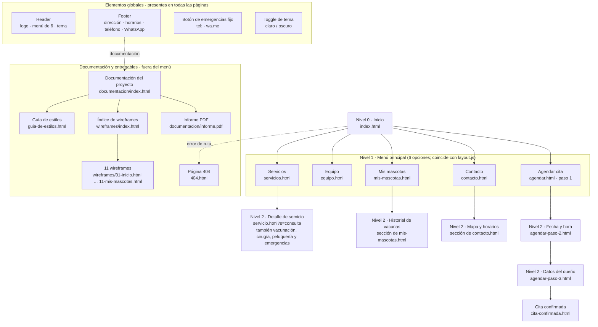
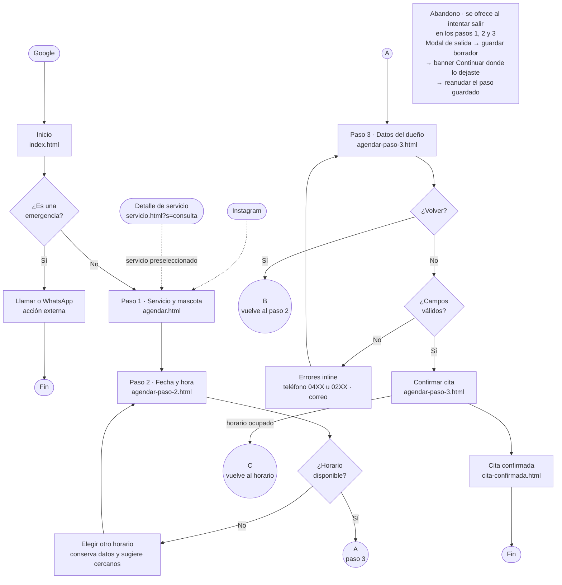

# Arquitectura de información y flujo — Patitas Felices

**Proyecto:** sitio web de la clínica veterinaria Patitas Felices (Caracas, Venezuela)  
**Autor:** Lenin Alvarado  
**Fecha:** 2026-10-29  
**Alcance:** card sorting y sitemap (S4), user flow de “agendar una cita” (S5).  
**Documento relacionado:** `docs/01-investigacion.md` (proto-personas, journey y features F01–F08).

> **Regla de trabajo.** El menú principal debe coincidir con `site/assets/js/layout.js`. En el commit `bf13d95` el arreglo `NAV_ITEMS` tiene seis opciones, en este orden: **Inicio, Servicios, Equipo, Mis mascotas, Contacto, Agendar cita**. Este documento respeta ese contrato; **no se modificó `layout.js`** porque no hay diferencias.

---

## 1. Card sorting (S4)

### 1.1. Inventario de tarjetas de contenido

Se listan todas las tarjetas de contenido que el sitio necesita, incluyendo las pantallas obligatorias, la sección opcional “Mis mascotas” y los entregables de documentación.

| ID | Tarjeta de contenido | Pantalla o archivo previsto | Prioridad |
|---|---|---|---|
| C01 | Propuesta de valor, 8 años de trayectoria y sede en Caracas | `index.html`, `equipo.html` | Must |
| C02 | Llamado a la acción “Agendar cita” | Global, `index.html` | Must |
| C03 | Emergencias 24/7 con llamada y WhatsApp | Global (header, dock, contacto) | Must |
| C04 | Servicios con duración y precio referencial (consulta, vacunación, cirugía, peluquería, emergencias) | `servicios.html`, `index.html` | Must |
| C05 | Detalle de un servicio: qué incluye, preparación y precio | `servicio.html?s=consulta` (plantilla para los cinco slugs) | Must |
| C06 | Equipo veterinario y especialidades | `equipo.html` | Must |
| C07 | Testimonios y prueba social | `index.html`, `equipo.html` | Must |
| C08 | Horarios de atención y urgencias | `contacto.html`, footer global | Must |
| C09 | Dirección, mapa y cómo llegar | `contacto.html`, footer global | Must |
| C10 | Teléfono +58 y WhatsApp | Global (header, footer y contacto) | Must |
| C11 | Agendar paso 1: servicio y datos de la mascota (tipo, nombre, edad) | `agendar.html` | Must |
| C12 | Agendar paso 2: fecha y hora con disponibilidad | `agendar-paso-2.html` | Must |
| C13 | Agendar paso 3: datos del dueño y resumen para confirmar | `agendar-paso-3.html` | Must |
| C14 | Cita confirmada: resumen, sede, fecha y hora | `cita-confirmada.html` | Must |
| C15 | Compartir por WhatsApp y agregar al calendario | `cita-confirmada.html` | Must |
| C16 | Mis mascotas: perfiles de las mascotas | `mis-mascotas.html` | Should |
| C17 | Historial de vacunas por mascota | `mis-mascotas.html` | Should |
| C18 | Recordatorios de próximas vacunas y controles | `mis-mascotas.html`, confirmación | Should |
| C19 | Página 404 con estilo de marca y salida a Inicio | `404.html` | Must |
| C20 | Guía de estilos y sistema de diseño | `guia-de-estilos.html` | Must |
| C21 | Índice de wireframes | `wireframes/index.html` | Must |
| C22 | Diez wireframes de las pantallas requeridas | `wireframes/*.html` | Must |
| C23 | Selector de tema claro/oscuro | Global (header) | Should |
| C24 | Header con logo, menú, tema y menú móvil | Global | Must |
| C25 | Footer con dirección, horarios, teléfono, WhatsApp y enlaces de documentación | Global | Must |
| C26 | Nota de moneda: “o su equivalente en Bs a tasa BCV del día” | `servicios.html`, detalle y reserva | Must |

### 1.2. Agrupación de Camila — reserva rápida y precio claro

| Grupo que propone Camila | Tarjetas | Criterio |
|---|---|---|
| **Urgencia y contacto** | C03, C08, C09, C10, C24 | Lo primero que necesita si Miga está mal: saber si puede ir, dónde y a qué teléfono. |
| **Elegir y comparar** | C01, C04, C05, C06, C07, C26 | Quiere entender el servicio, ver el precio en USD/BCV y confirmar que la clínica es confiable. |
| **Reservar** | C02, C11, C12, C13, C14, C15 | El flujo completo, con disponibilidad real y confirmación compartible. |
| **Después de la cita** | C16, C17, C18 | Historial y recordatorios para no volver a buscar en papeles. |
| **Sistema y documentación** | C19, C20, C21, C22, C23, C25 | Páginas de soporte y entregables; no son contenido de decisión. |

### 1.3. Agrupación de Rafael — emergencia, teléfono y registro

| Grupo que propone Rafael | Tarjetas | Criterio |
|---|---|---|
| **Emergencia ya** | C03, C08, C09, C10 | Necesita llamar o ir ahora; no quiere navegar. |
| **La clínica** | C01, C04, C05, C06, C07, C26 | Quiere saber quiénes son, qué hacen y si son confiables. |
| **Mis mascotas** | C16, C17, C18 | Rocky, Luna y Canela en un solo lugar; el historial reemplaza la carpeta física. |
| **Citas** | C02, C11, C12, C13, C14, C15 | Agendar con pocos campos y confirmación clara. |
| **Sistema y documentación** | C19, C20, C21, C22, C23, C24, C25 | Lo global y lo técnico, separado de las tareas. |

### 1.4. Agrupación de la familia Rojas — confianza y planificación

| Grupo que propone la familia | Tarjetas | Criterio |
|---|---|---|
| **Confianza** | C01, C06, C07 | Antes de pagar quiere saber quién atiende a Bruno y qué dicen otras familias. |
| **Servicios y precios** | C04, C05, C26 | Compara qué incluye y cuánto cuesta; la nota BCV evita sorpresas. |
| **Planificar la cita** | C02, C03, C08, C09, C10, C11, C12, C13, C14, C15 | Horario, sede, calendario, datos y confirmación en una sola secuencia. |
| **Seguimiento** | C16, C17, C18 | Vacunas y recordatorios para la guardería, viajes y controles. |
| **Sistema y documentación** | C19, C20, C21, C22, C23, C24, C25 | Footer, guía y wireframes; soporte del proyecto. |

### 1.5. Comparación y conclusión del card sorting

| Tema | Camila | Rafael | Familia Rojas | Decisión de arquitectura |
|---|---|---|---|---|
| Urgencia y contacto | Primer grupo | Primer grupo | Dentro de “Planificar” | **Global**: botón fijo + datos en header/footer; no una página aparte. |
| Servicios y precios | “Elegir y comparar” | Dentro de “La clínica” | “Servicios y precios” | Un solo nivel: `servicios.html` + detalle. |
| Reserva | “Reservar” | “Citas” | “Planificar” | Flujo lineal de 3 pasos + confirmación; no se fragmenta en el menú. |
| Confianza | Dentro de “Elegir” | “La clínica” | Primer grupo | Inicio y Equipo; no un ítem de menú adicional. |
| Mis mascotas | “Después” | “Mis mascotas” | “Seguimiento” | **Ítem de menú propio** por el peso del historial de vacunas. |
| Documentación | “Sistema” | “Sistema” | “Sistema” | Fuera del menú; enlaces de footer y carpeta `wireframes/`. |

**Conclusión:** los tres perfiles coinciden en cinco bloques estables —urgencia/contacto, servicios/precios, reserva, confianza y seguimiento— y difieren en el orden y la profundidad. Esa coincidencia sostiene un menú de seis opciones sin submenús: Inicio, Servicios, Equipo, Mis mascotas, Contacto y Agendar cita. La emergencia no compite por un ítem porque es global; la documentación tampoco entra al menú porque no es una tarea del cliente.

---

## 2. Sitemap (S4)

### 2.1. Contrato de navegación comprobado

| Posición | Etiqueta visible | Archivo | Tipo |
|---|---|---|---|
| 1 | Inicio | `index.html` | Enlace de texto |
| 2 | Servicios | `servicios.html` | Enlace de texto |
| 3 | Equipo | `equipo.html` | Enlace de texto |
| 4 | Mis mascotas | `mis-mascotas.html` | Enlace de texto |
| 5 | Contacto | `contacto.html` | Enlace de texto |
| 6 | Agendar cita | `agendar.html` | CTA primario |

- **Total: 6 opciones**, el máximo del brief.
- Coincide exactamente con `NAV_ITEMS` de `site/assets/js/layout.js` (commit `bf13d95`). No se editó ese archivo.
- `Inicio` es el nivel 0 del árbol y, a la vez, la primera opción del menú; las otras cinco cuelgan de él.

### 2.2. Árbol de navegación

*Fuente editable:* [`assets/sitemap.mmd`](assets/sitemap.mmd).

### 2.3. Pantallas y niveles

| Nivel | Página / sección | Archivo | Cómo se llega |
|---|---|---|---|
| 0 | Inicio | `index.html` | URL raíz o logo. |
| 1 | Servicios | `servicios.html` | Menú. |
| 2 | Detalle de servicio | `servicio.html?s=consulta` (slugs: vacunación, cirugía, peluquería, emergencias) | Tarjeta de Inicio o lista de Servicios. |
| 1 | Equipo | `equipo.html` | Menú. |
| 1 | Mis mascotas | `mis-mascotas.html` | Menú. |
| 2 | Historial de vacunas | Sección de `mis-mascotas.html` | Selección de mascota. |
| 1 | Contacto | `contacto.html` | Menú. |
| 2 | Mapa y horarios | Sección de `contacto.html` | Ancla o scroll. |
| 1 | Agendar cita — paso 1 | `agendar.html` | Menú/CTA; también entrada directa desde Instagram. |
| 2 | Agendar — paso 2 | `agendar-paso-2.html` | Continuar desde paso 1. |
| 2 | Agendar — paso 3 | `agendar-paso-3.html` | Continuar desde paso 2. |
| 2 | Cita confirmada | `cita-confirmada.html` | Confirmar en paso 3. |
| — | Página 404 | `404.html` | Error de ruta; enlace a Inicio. |
| — | Documentación del proyecto | `documentacion/index.html` | Footer → Documentación. |
| — | Investigación, Arquitectura, Decisiones | `documentacion/investigacion.html`, `arquitectura.html`, `decisiones.html` | Hub de documentación. |
| — | Archivo de diseño | `documentacion/pantallas.html` | Hub de documentación. |
| — | Informe PDF | `documentacion/informe.pdf` | Hub de documentación (descarga). |
| — | Guía de estilos | `guia-de-estilos.html` | Archivo de diseño → Guía de estilos; también enlace directo. |
| — | Índice de wireframes | `wireframes/index.html` | Archivo de diseño → Wireframes. |
| — | Wireframes 01–11 | `wireframes/*.html` | Índice de wireframes. |

**Las diez pantallas obligatorias están cubiertas:** Inicio, Servicios, Detalle de servicio, Equipo, Agendar pasos 1–3, Cita confirmada, Contacto y 404. Además se incluyen “Mis mascotas”, la guía de estilos y los wireframes.

#### Wireframes (T4)

| # | Archivo | Pantalla |
|---|---|---|
| 01 | `wireframes/01-inicio.html` | Inicio |
| 02 | `wireframes/02-servicios.html` | Servicios |
| 03 | `wireframes/03-detalle-servicio.html` | Detalle de servicio |
| 04 | `wireframes/04-equipo.html` | Equipo |
| 05 | `wireframes/05-agendar-paso-1.html` | Agendar paso 1 |
| 06 | `wireframes/06-agendar-paso-2.html` | Agendar paso 2 |
| 07 | `wireframes/07-agendar-paso-3.html` | Agendar paso 3 |
| 08 | `wireframes/08-cita-confirmada.html` | Cita confirmada |
| 09 | `wireframes/09-contacto.html` | Contacto y ubicación |
| 10 | `wireframes/10-404.html` | 404 |

### 2.4. Profundidad de clics desde Inicio

| Destino | Clics | Ruta |
|---|---:|---|
| Inicio | 0 | — |
| Servicios | 1 | Inicio → menú Servicios |
| Equipo | 1 | Inicio → menú Equipo |
| Mis mascotas | 1 | Inicio → menú Mis mascotas |
| Contacto | 1 | Inicio → menú Contacto |
| Agendar — paso 1 | 1 | Inicio → CTA/menú Agendar cita |
| Detalle de servicio | 1–2 | Tarjeta destacada de Inicio (1) o Servicios → detalle (2) |
| Historial de vacunas | 1 | Mis mascotas → seleccionar mascota (sección) |
| Agendar — paso 2 | 2 | Paso 1 → Continuar |
| Agendar — paso 3 | 3 | Paso 1 → Paso 2 → Continuar |
| Cita confirmada | n/a | Estado final del flujo: se llega tras 4 acciones de avance, no por navegación (ver 3.5) |
| Documentación del proyecto | 1 | Inicio → footer Documentación |
| Investigación / Arquitectura / Decisiones | 2 | Footer → Documentación → documento |
| Archivo de diseño | 2 | Footer → Documentación → Archivo de diseño |
| Guía de estilos | 3 | Footer → Documentación → Archivo de diseño → Guía |
| Índice de wireframes | 3 | Footer → Documentación → Archivo de diseño → Wireframes |
| Wireframe individual | 4 | Anexo de documentación: índice → wireframe (no es una página de cliente) |
| 404 | n/a | Solo por error de ruta; no es un destino de navegación |

> **Cómo se lee la tabla.** La profundidad de navegación se mide en enlaces de arquitectura. Las páginas de cliente y la documentación principal están a **≤3 clics**; el wireframe individual es un anexo de documentación a 4 clics. La confirmación es el estado final de un flujo transaccional lineal, no una página que el usuario deba descubrir; sus pasos se cuentan en la sección 3.5 (5 pantallas, 4 clics de avance).

> **Documentación fuera del menú.** El footer enlaza a `documentacion/index.html`, que reúne investigación, arquitectura, decisiones, archivo de diseño e informe PDF. La guía de estilos y los wireframes cuelgan del archivo de diseño. Las páginas de cliente se mantienen a ≤3 clics; el wireframe individual es un anexo de documentación a 4 clics y no compite con el menú de seis opciones.

### 2.5. Justificación del sitemap

El menú de seis opciones cubre las cinco tareas principales sin submenús: informarse, conocer al equipo, volver a las mascotas, contactar y agendar.  
Los detalles de servicio viven bajo Servicios y la reserva se mantiene como un flujo lineal, no como una maraña de páginas en el menú.  
“Mis mascotas” merece un ítem propio porque el historial de vacunas es una razón de retorno, no un extra escondido.  
La guía de estilos y los wireframes quedan fuera del menú de clientes, enlazados desde el footer como documentación del proyecto.

---

## 3. User flow “Agendar una cita” (S5)

### 3.1. Puntos de entrada

| Entrada | Destino | Notas |
|---|---|---|
| Google / búsqueda orgánica | `index.html` | Entrada principal; el usuario ve la propuesta y el CTA. |
| Enlace de Instagram | `agendar.html` | Entrada directa al paso 1, sin pasar por Inicio. |
| Detalle de servicio | `agendar.html?servicio=consulta` | El servicio llega preseleccionado; el paso 1 solo pide la mascota. |
| Botón global de emergencias | `tel:` / `wa.me` | No es una entrada al agendamiento; interrumpe el flujo para atención urgente. |

### 3.2. Diagrama de flujo

*Fuente editable:* [`assets/user-flow.mmd`](assets/user-flow.mmd). Los círculos **A**, **B** y **C** son conectores de continuación entre las dos columnas del diagrama: **A** sigue en el paso 3, **B** vuelve al paso 2 conservando los datos y **C** vuelve a elegir horario cuando el turno se ocupó al confirmar. La nota **Abandono** aplica a los pasos 1, 2 y 3.

### 3.3. Camino ideal y pantallas

| Orden | Etapa del camino ideal | Pantalla / archivo | Acción del usuario |
|---:|---|---|---|
| 1 | Inicio | `index.html` | Pulsa “Agendar cita” o “Continuar donde lo dejaste”. |
| 2 | Elegir servicio | `agendar.html` | Selecciona uno de los cinco servicios. |
| 3 | Datos de la mascota | `agendar.html` | Elige tipo, nombre y edad; el servicio se conserva. |
| 4 | Fecha y hora | `agendar-paso-2.html` | Elige un día y un horario disponible de 30 minutos. |
| 5 | Datos del dueño | `agendar-paso-3.html` | Completa nombre, teléfono, correo y acepta el resumen. |
| 6 | Confirmar | `agendar-paso-3.html` | Revisa y pulsa “Confirmar cita”; aquí se validan los campos. |
| 7 | Cita confirmada | `cita-confirmada.html` | Comparte por WhatsApp o agrega al calendario. |

**Nota de contrato:** el paso 1 agrupa “elegir servicio” y “datos de la mascota” en **una sola pantalla**, tal como exige la pantalla 5 del brief. El paso 3 agrupa “datos del dueño” y “confirmar” en **una sola pantalla**, tal como exige la pantalla 7. Por eso el camino ideal tiene 7 etapas de contenido, pero **5 pantallas**.

### 3.4. Rutas alternativas obligatorias

| Condición | Comportamiento esperado | Pantalla / archivo | Feature |
|---|---|---|---|
| **¿Es una emergencia?** Sí | Llamar o abrir WhatsApp de inmediato; no se pide formulario. El botón de emergencia está en todas las pantallas. | Acción externa `tel:` / `wa.me`; CTA global | F01 |
| **El horario elegido ya no está disponible** | Volver a la selección de fecha/hora conservando servicio y mascota; mostrar los 3 horarios más cercanos y un mensaje claro. | `agendar-paso-2.html` | F03, F05 |
| **Campos vacíos o con formato incorrecto** | Errores inline junto al campo, borde de error, `aria-invalid` y `aria-describedby`; mantener el foco y no avanzar. Teléfono venezolano de 11 dígitos: móvil `04XX-XXXXXXX` o fijo `02XX-XXXXXXX`; correo válido. | `agendar-paso-3.html` | F05 |
| **El usuario quiere volver al paso anterior** | Botón “Volver” que conserva todos los valores y el horario; no reinicia el flujo. | `agendar-paso-2.html` / `agendar-paso-3.html` | F04 |
| **El usuario abandona a la mitad** | Modal de salida (“Seguir agendando” / “Guardar y salir”); guardar borrador en `sessionStorage`; al volver, banner “Continuar donde lo dejaste” y reanudar el paso guardado. | `agendar.html` y pasos 2–3; modal de salida | F04 |
| **El usuario llega desde Instagram** | Entrada directa al paso 1 (`agendar.html`) sin obligarlo a pasar por Inicio. | `agendar.html` | F04 |
| **El usuario llega desde un detalle de servicio** | El servicio llega preseleccionado; el paso 1 pide solo la mascota. | `agendar.html?servicio=consulta` | F02, F04 |

### 3.5. Conteo de clics, pantallas y tiempo

| Métrica | Valor |
|---|---:|
| Pantallas del camino ideal (incluyendo Inicio y confirmación) | **5** |
| Etapas de contenido del brief | **7** |
| Clics de avance desde Inicio hasta “Cita confirmada” | **4** |
| Campos de texto obligatorios del flujo | **5** (nombre y edad de la mascota; nombre, teléfono y correo del dueño) |
| Objetivo de tiempo | **≤ 2 minutos**; diseño objetivo ≈ **100 s** |

**Desglose de la estimación (no es una medición con usuarios):** 15 s para elegir servicio, 20 s para los datos de la mascota, 25 s para fecha/hora, 35 s para los datos del dueño y la revisión, 5 s para confirmar. La cifra se validará con el prototipo de T6 y la QA de T7; si el usuario ya tiene un borrador, el tiempo baja.

### 3.6. Contrato de pantallas para T6

| Archivo | Propósito | Datos / estados obligatorios |
|---|---|---|
| `site/agendar.html` | Paso 1: servicio + mascota; entrada directa y reanudación | Servicio preseleccionado opcional; tipo, nombre y edad de la mascota (número + unidad); stepper; validación; botón Continuar; banner de borrador si existe. |
| `site/agendar-paso-2.html` | Paso 2: fecha y hora | Calendario con disponibilidad; slots de 30 min; estados disponible/seleccionado/no disponible; mensaje de “horario ya no disponible” y 3 cercanos; conservar paso 1. |
| `site/agendar-paso-3.html` | Paso 3: datos del dueño + resumen + confirmar | Nombre, teléfono, correo; resumen de servicio/mascota/fecha/hora; errores inline; botón Volver; confirmación. |
| `site/cita-confirmada.html` | Cita confirmada | Resumen, WhatsApp, agregar al calendario, enlace a Mis mascotas/Inicio. |
| `site/mis-mascotas.html` | Perfiles e historial de vacunas | Mascotas de ejemplo, vacunas, próximos recordatorios. |
| Modal de salida | Confirmación de abandono | “Seguir agendando” / “Guardar y salir”; si guarda, escribe el borrador. |
| Banner de reanudación | “Continuar donde lo dejaste” | Visible en `agendar.html` si hay borrador vigente; permite retomar el paso guardado o descartarlo. |

**Contrato técnico del borrador y validación:**

- Clave de `sessionStorage`: `pf-booking-draft`; guarda servicio, mascota, fecha, hora y datos del dueño; caducidad lógica de **24 h**; no se envía al servidor.
- Teléfono: `^(?:04(?:12|14|16|24|26)|02\d{2})-?\d{7}$` (móvil `04XX-XXXXXXX` o fijo `02XX-XXXXXXX`, 11 dígitos); mensaje de error en español con ejemplos `0412-5550198` y `0212-5551234`.
- Edad: entero positivo + unidad `meses` o `años`; el borrador guarda `petAgeValue`, `petAgeUnit` y `petAge` compuesto. Los borradores antiguos con edad en texto libre se migran al cargar.
- Correo: validación estándar `^[^\s@]+@[^\s@]+\.[^\s@]+$`; mensaje inline.
- Los errores usan `aria-invalid="true"`, `aria-describedby` y un contenedor con `role="alert"` o `aria-live="polite"`; nunca solo color.
- El modal de salida devuelve el foco al botón que lo abrió; el banner de reanudación es un `role="status"` y tiene botones “Continuar” y “Descartar”.
- La reserva conserva los datos al volver al paso anterior; no debe reiniciar el formulario.
- Todos los controles mantienen el objetivo táctil de **48 px** y el foco visible definido en la guía de estilos.

### 3.7. Trazabilidad S4/S5

| Spec | Dónde se cubre |
|---|---|
| S4 — card sorting, sitemap, menú ≤6, niveles, elementos globales, 10 pantallas, profundidad ≤3, justificación | Secciones 1 y 2 |
| S5 — flujo estándar, 2+ entradas, camino ideal, alternativas, conteo y meta <2 min, archivos por pantalla | Sección 3 |
